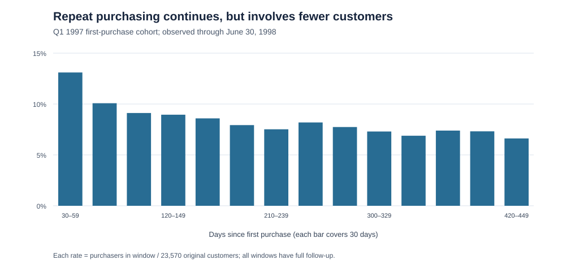
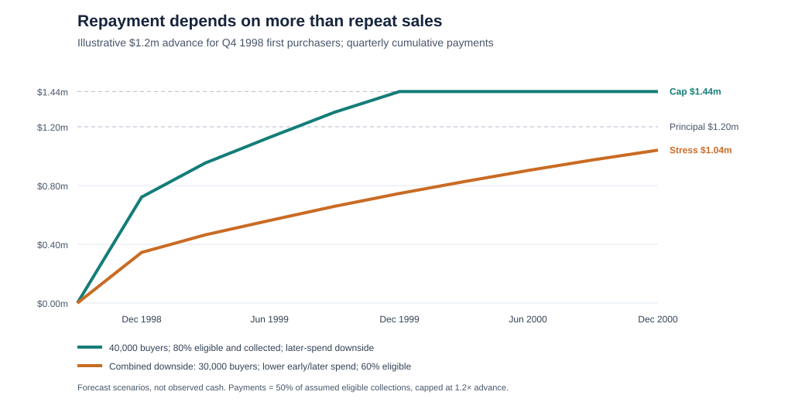

# CDNow: Recommendation for cohort-based financing

**Investment committee memo | Decision as of July 15, 1998**

**Scope:** This historical assessment does not take into account large-scale changes in how media is distributed, shared, or consumed.

## Decision

**Decision: no investment now; advance $0.** I would investigate up to a **$1.2 million fixed advance** for a proposed Q4 1998 first-purchase cohort, subject to its acquisition budget and repayment capacity. Before funding, I would ask CDnow for planned marketing, advertising, and distribution spending by channel and evidence that those channels could produce the assumed buyer count. I would also need evidence that the cohort's sales can cover customer-serving costs and our 50% share, and a reliable way to verify and collect payments alongside its other obligations. Otherwise, pass. Repeat buying is real in the supplied cohort, but the investor's gain is capped at 20% and the available figures do not show whether CDnow could afford the required payments.

## Revenue quality: persistence with concentration

The provided data records **$2,500,315.63 in transaction dollars** from **23,570 Q1 1997 first purchasers** across **69,659 rows through June 30, 1998**. It gives transaction dates and amounts but no refunds, shipment status, or cash receipts, so those dollars cannot yet be reconciled to net sales or a prospective loan's repayment base. **11,516 customers (48.9% of the original 23,570)** bought on a later date; **68.6% of all recorded dollars** came after first-purchase dates. In the fully-observable days 420–449 window, **1,560 customers (6.6% of the original group)** bought, generating **$75,142**, versus **$990,452 in days 0–29**, which include required first purchases. Repeat dollars persist but fall substantially with customer age; the [cohort findings](../reports/cohort_findings.md) show the intervening periods.

The highest-spending 10%, ranked using their full observed histories, generated **50.9% of observed dollars**. That ranking describes concentration but cannot identify high-value Q4 1998 buyers before an advance is set. Early repeat purchases could help us judge how a funded cohort is doing: **6,864 customers (29.1% of the original group)** bought again by day 89 and generated **68.3% of days 90–449 dollars**. Even so, that signal arrives after initial funding and does not explain why they returned; a [0-90 day diagnostic](../reports/early90_diagnostic.md) compares both groups at equal follow-up.

*Share of the original 23,570 customers with a recorded purchase in each complete 30-day age window. Days 0–29 contain the required first purchase and are omitted. This shows observed activity, not churn or forecast revenue. Source: [cohort analysis](../reports/cohort_analysis.json); [chart script](../scripts/render_memo_comparison_charts.py).*

**[CDnow, Inc., Prospectus, dated February 9, 1998 (SEC Form 424B1, filed February 11)](../CDNOW_data/SEC_424B1.txt)** reports that repeat customers across all company cohorts produced **over 50% of 1997 net sales** (pp. 3, 30). Together with this cohort's repeat purchases, that supports a judgment that some near-term repeat revenue is likely. Neither source establishes its amount or a numerical probability for a new cohort with different acquisition channels or customers.

## Forecast for a new Q4 1998 cohort

The proposed test cohort consists of customers making their **first CDnow purchase October 1–December 31, 1998**. The previously cited February 1998 prospectus reports approximately **209,000 first purchasers in 1997** (pp. 3, 5–6). Subtracting the provided dataset's **23,570 Q1 1997** first purchasers means **61,810 per quarter on average**, if the two sources count first purchasers the same way. The prospectus does not report any of those quarters separately, and this rough 1997 average does not predict Q4 1998. The **62,000** case rounds it; **40,000** is a lower-count scenario about 35% below it, and **90,000** tests stronger acquisition. None is a measured or probability-weighted Q4 forecast.

Contemporaneous evidence makes higher cohort counts plausible but cannot pinpoint a number: [*Stereophile* reported on May 3, 1998](https://www.stereophile.com/content/cdnow-tops-chart-expands-europe) that CDnow had **$10 million Q1 1998 company revenue** and **135,000 new registrations**, while [an $18.5 million, three-year exclusive partnership agreement with Lycos and expanded partnership with Yahoo! was reported by *Wired* on April 10](https://www.wired.com/1998/04/dealing-for-dollars/). Registrations are not first purchasers, and neither article measures conversion or acquisition cost. The [research notes](../reports/future_cohort_size_scenarios.md) explain what those reports can and cannot tell us about the Q4 buyer count.

Day 449 ends the last complete 30-day customer-age window we can observe for **every** Q1 1997 buyer by June 30, 1998, so it gives all customers equal follow-up. For each hypothetical Q4 buyer, the model transfers the Q1 1997 cohort's spending by **days since first purchase** through day 449. For older ages it starts with spending per original customer in the latest three complete 30-day windows and reduces it by the change from the preceding three; the implied decline is about **7% per 90 days**. I compared the **three-window decline** with a **log-linear trend**, which fitted a constant percentage change to spending per original customer across earlier 30-day age windows. On held-out days 360–449, the log-linear forecast was **1.6% below** actual sales; the three-window forecast was **4.3% above**. Log-linear also had the smaller error in the other three holdouts. Those holdouts overlapped and tested only 60–180 days from this one cohort, while the Q4 projection ran much farther. The log-linear projection also changed depending on which early age windows I included in the fit. I chose the three-window decline as a working case, not as a proven winner. Before funding, I would test the repayment results under both methods. The [method comparison](../reports/forecast_extensions.md) and [benchmark](../reports/trend_benchmark.md) show the tests. At the original cohort's size, **75% of projected dollars through December 2000 copies observed age-0–449 rates; 25% extrapolates older ages**. Both are forecasts for *new* buyers. The model spreads first purchases evenly across Q4; holiday clustering would alter cash timing, and customers brought in through CDnow’s newer Lycos and Yahoo promotions might spend different amounts on their first orders and return at different rates than the Q1 1997 buyers.

| Assumed Q4 first purchasers | Provisional reported dollars, Oct. 1998–Dec. 2000 | 20% relative fewer early repeaters | 20% less later spending by first-90-day top quarter |
| ---: | ---: | ---: | ---: |
| 40,000 | $5.356m | $5.020m | $4.949m |
| 62,000 | $8.301m | $7.781m | $7.671m |
| 90,000 | $12.050m | $11.295m | $11.136m |

These are **forecast transaction dollars**, before eligibility or collection. In the first downside, the share of customers who buy again by day 89 falls **20% relative, from 29.1% to 23.3%**; the assumed lost early repeaters instead receive the observed later-spending rate of customers without an early repeat. In the second, the forecast contribution of the quarter of customers with the highest *first-90-day spend* falls by 20%. These are alternative stresses on overlapping customers, so I do not add their losses. Both leave initial spending unchanged; the combined downside in the financing section also reduces spending during buyers’ first 90 days by 15%.

## Financing and the $1.2 million ceiling

If CDnow verifies its 1998 Q4 acquisition budget, shows it can serve customers while remitting half of eligible sales, and agrees with us on which cohort sales count toward repayment and how and when our share will be paid, I would consider an advance of up to $1.2 million under the proposed structure.

CDnow would repay **50% of eligible revenue from Q4 first-purchase IDs**, including modeled first and later purchases, until repayments total **1.2 times the fixed advance**; nothing more is due from that cohort once the cap is reached. A **$1.2 million** advance therefore requires **$2.88 million eligible revenue** for the **$1.44 million repayment cap** and **$240,000 maximum gross gain**. The model assumes same-day collection and remittance. Actual collection and remittance timing are unknown, so the modeled cap dates may be later. I chose 80% to show how repayments change if some reported sales are excluded or never collected: **$100 of forecast transaction dollars becomes $80 eligible and collected, and 50% of that $80, or $40, goes to repayment** until the cap. CDnow has not provided evidence that 80% is the right figure.

The forecast table tests **40,000, 62,000, and 90,000** Q4 buyers. I use the **40,000-buyer lower-count scenario** for the main financing test to see how the advance fares with fewer buyers than the rough 1997 quarterly average. The chart below turns that case with lower later spending into modeled repayments, then adds a **30,000-buyer combined stress** below the table's range to test whether principal could remain unpaid. Both use the same proposed $1.2 million advance.

*Modeled repayments, not observed cash or expected returns. Green: 40,000 buyers, 20% less later spending by the first-90-day top quarter, 80% eligible and collected; cap reached December 22, 1999. Orange: 30,000 buyers, 15% less days 0–89 spending, the same later-spending stress, 60% eligible and collected; **$1.041m repaid by December 2000, with $159k principal unrecovered then**. The separate early-repeat downside caps December 14, 1999. Both plotted paths assume same-day collection and show quarter-end totals. Source: [scenarios](../reports/future_cohort_size_scenarios.json); [chart script](../scripts/render_memo_comparison_charts.py).*

**Why test $1.2 million?** With 40,000 assumed Q4 buyers and an illustrative 80% eligible-and-collected share, that fixed advance reaches its cap by December 1999 under either separate behavior downside above. At **$2.4 million**, the same 40,000-buyer top-quarter case returns only **$1.980 million by December 2000**, below principal: a larger advance does not itself create more buyers. Conversely, if Q4 had only **23,570 buyers**, the $1.2 million advance returns **$1.167 million by December 2000** in that case, also below principal. The $1.2 million figure is thus a bounded **$30 per assumed 40,000 buyers** to investigate, not an observed acquisition budget or a safe-return estimate. The Q1 1997 cohort recorded about $101 per customer in its first 450 fully observed days. At a 50% repayment share, a $30 advance per buyer needs $72 of eligible revenue per buyer to reach its $36 repayment cap. The observed sales scale makes that revenue hurdle worth testing; it does not show that $30 per buyer matches CDnow's acquisition budget or leaves enough cash after serving those buyers.

In the 40,000-buyer top-quarter case, principal recovery by December 2000 requires **48.5%** of forecast transaction dollars to be eligible and collected; reaching the cap requires **58.2%**. Both hurdles are below the 80% assumption used in the chart, which is why that case reaches the cap in the model. The combined case is illustrative, not a probability estimate, and later receipts are unmodeled.

The previously cited February 1998 prospectus reports **$17.37 million 1997 company net sales**, **$2.83 million gross profit (16.3%)**, **$9.24 million sales and marketing expense**, and **$10.75 million net loss** (pp. 5, 21–22, F-4). Those figures cover the whole company in 1997; they do not show what it would cost to acquire and serve the proposed Q4 cohort or how much cash its sales would leave for repayment. At an illustrative 80% eligible fraction, the share claims **40 cents per reported sales dollar**, versus roughly **16 cents of historical company gross profit per net-sales dollar**. The measures differ, but the gap makes borrower payment capacity a central question: CDnow must buy, ship, and service CDs while remitting part of sales. Until CDnow shows the cash left after acquiring and serving the cohort, a modeled cap date cannot establish its ability to pay; the prioritized requests below define that check.

## Opportunity cost and investment mandate

A CDnow advance would commit capital that Titanium Branch could deploy in other investments worldwide or reserve for its mission. The available evidence does not identify those alternatives, so it cannot quantify the opportunity cost or establish that CDnow is the best use of the funds. The financed marketing and physical-CD distribution have no demonstrated direct link to the mission; any mission benefit would come indirectly from investment returns. Before comparing uses of capital, I would ask what opportunities TB would forgo and assess them alongside CDnow on expected cash returns, downside risk, timing, and mission value.

## Information requests that could alter the decision

1. **Acquisition plan:** Q4 spend and timing, requested advance, incremental purchasers by channel, and alliance-cost allocation. This tests whether $1.2 million matches the planned spending and whether the 40,000-buyer case is plausible.
2. **Cash left for repayment:** For comparable cohorts, show sales less CDs, fulfillment, shipping, fees, refunds, support, and acquisition spending, then show whether enough remains to pay our share. Pass if those sales cannot cover both the costs and payments.
3. **Eligible collections:** Reconcile this file's transaction dollars to shipped, net, collected, and eligible sales; confirm remittance timing, auditability, and creditor claims.
4. **Comparability and liquidity:** Q2 1997–Q2 1998 cohorts by channel and customer age, plus current cash and committed alliance payments. These test forecast transfer and payment capacity.

**Next step:** Test up to $1.2 million against the Q4 spending plan, cash left after cohort costs, and eligible collections. Reduce the amount or pass if those checks fail.

## Afterword: what a later cutoff changes

CDnow's Q2 1998 10-Q, **filed July 28**, later disclosed substantial first-half operating cash use and remaining alliance commitments. **That was unavailable on July 15 and informed none of the calculations above.** At a late-July meeting, I would revisit even the conditional ceiling: those competing cash demands raise the question of whether CDnow could remit half of eligible cohort sales while meeting its other obligations. The [separate source note](../docs/post_cutoff_financing_note.md) gives the filing figures and their limits.
